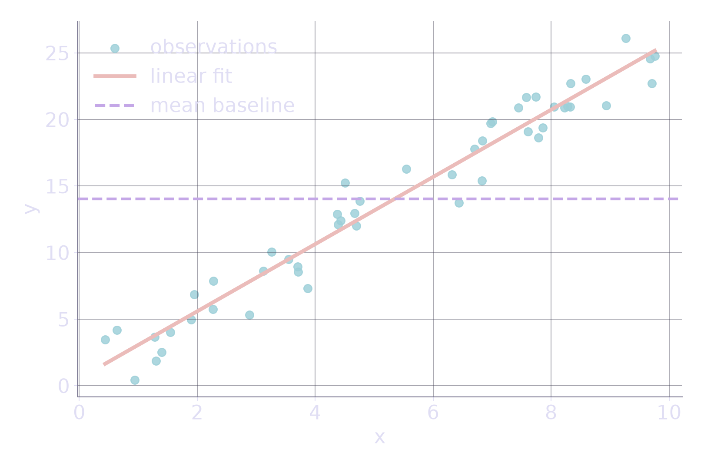

# Python and NumPy for machine learning

**Today**: 

- Basic programming, elementary linear algebra, means, and variances.

**Before we start:**

-  Check that you have a working python environment

---

## Today

By the end of this session, you can:

1. write small Python functions with lists, loops, and comprehensions;
2. reason about NumPy **shapes**, **dtypes**, and **axes**;
3. vectorize a calculation instead of writing loops;
4. generate reproducible data with an explicit random-number generator;
5. **fit, predict, and evaluate** a univariate linear-regression model;
6. verify results with invariants and `numpy.linalg.lstsq`.

---

## Course roadmap

1. Python, NumPy, SciPy, and linear regression
2. Ridge regression with GD, momentum/NAG, and SGD
3. Elastic Net with proximal gradient descent
4. Gaussian mixtures with projected gradient and EM
5. Reproducibility, metrics, and evaluation
6. Final exam

---

## Assessment

- **Duration:** three hours in class
- **Resources:** access to online documentation
- **Not allowed:** LLM assistance
- **Format:** one exercise closely related to class work

A typical exam asks you to adapt an optimization algorithm or apply the course methods to a real-world problem.

---

<!-- _class: lead -->
<!-- header: ENSAI · Python essentials -->

# Python essentials 🐍

The syntax needed for today's fit–predict–evaluate workflow.

---

## How Python runs

- You run a Python file directly. There is no separate compile step before you see results.
- Statements run in order, top to bottom.
- A function's body runs only when you call it.
- When something fails, read the **last** line of the error first.

:bulb: Libraries like NumPy move the heavy numerical work into fast compiled code (details in appendix B)

---

## Run a script

`hello.py`:

```python
message = "Hello, world!"
print(message)
```

From the repository environment:

```bash
uv run python hello.py
```

Output:

```text
Hello, world!
```

`uv` handles the Python environment for you. See the *Python tooling & environments* part of the appendix for `uv init`, `uv sync`, and how environments work.

---

## Names, values, and types

The four classic types:

```python
x = 42           # int
pi = 3.14        # float
name = "Alice"   # str
is_valid = True  # bool

print(type(x), type(pi))
```

- A name refers to a value.
- Values have runtime types; incompatible operations can fail at runtime.
- Type hints (`x: int = 42`) document intent for editors; Python does not enforce them.

---

## Strings

Combine strings in several ways:

```python
greeting = "Hello"
name = "Alice"
msg = f"{greeting}, {name}!"   # f-string: embed values

print(msg)  # Hello, Alice!
```

Many methods exist:

```python
text = "  Python Basics  "
text.strip()          # "Python Basics"
text.lower()          # "  python basics  " (whitespace preserved)
"-".join(["A", "B"])  # "A-B"
```

---

## Lists: ordered values

```python
values = [2.0, 4.0, 8.0, 16.0]

values[0]       # 2.0
values[-1]      # 16.0
values[1:3]     # [4.0, 8.0]
len(values)     # 4
```

Indexes start at zero. A slice includes its start and excludes its stop.

```text
 index       0    1    2     3
 value     2.0  4.0  8.0  16.0
```

---

## Lists are mutable

```python
values = [2.0, 4.0]
values.append(8.0)
values[0] = 1.0

print(values)  # [1.0, 4.0, 8.0]
```

Assignment does not copy a list:

```python
alias = values
alias.append(16.0)
print(values)  # [1.0, 4.0, 8.0, 16.0]
```

Use `values.copy()` for an independent shallow copy.

---

## Tuples: immutable, ordered

```python
point = (2, 3)
x, y = point     # unpacking

print(x)  # 2
```

- **Immutable**: once created, cannot be changed.
- **Ordered**: like lists, preserve insertion order.
- Support unpacking: `x, y = point`.

Use a tuple when the size and meaning are fixed, like a point `(x, y)`.

---

## Dictionaries map keys to values

```python
person = {"name": "Alice", "age": 30}

print(person["name"])  # Alice
```

Safely read and update:

```python
person.get("age", "unknown")   # 30
person.update({"age": 31})

print(person["age"])  # 31
```

Use a dict when you need lookup by a label rather than by integer index.

---

## Sets hold unique values

```python
tags = set([1, 2, 2, 3])
print(tags)  # {1, 2, 3}
```

```python
tags.add(4)
tags.union({5, 6})
```

Unordered iteration; duplicates are automatically removed; supports union, intersection, and difference; mutable.

---

## Conditions

```python
mse = 2.3
baseline_mse = 51.5

if mse < baseline_mse:
    print("the model beats the baseline")
else:
    print("check the implementation")
```

Blocks are defined by indentation. Comparisons produce Booleans.

Useful operators: `==`, `!=`, `<`, `<=`, `>`, `>=`, `and`, `or`, `not`.

---

## Loops and `range`

```python
squared = []
for value in range(5):
    squared.append(value**2)

print(squared)  # [0, 1, 4, 9, 16]
```

`range(5)` produces integers from `0` up to but not including `5`.

Use a loop when each iteration performs a meaningful step. Later, NumPy will replace many numerical loops with array operations.

---

## Comprehensions express simple transforms

Loop form:

```python
predictions = []
for value in x_values:
    predictions.append(intercept + slope * value)
```

Comprehension:

```python
predictions = [
    intercept + slope * value
    for value in x_values
]
```

Use the comprehension for a simple transform; keep the loop when the body has several steps.

---

## Iterate over paired data with `zip`

```python
observed = [3.0, 5.0, 8.0]
predicted = [2.5, 5.5, 7.0]

errors = []
for target, prediction in zip(observed, predicted):
    errors.append(target - prediction)

print(errors)  # [0.5, -0.5, 1.0]
```

`zip` stops at the shortest input. Validate equal lengths when silently dropping data would be an error.

---

## Functions package a contract

```python
def mean(values: list[float]) -> float:
    """Return the arithmetic mean of a non-empty list."""
    if not values:
        raise ValueError("mean requires at least one value")
    return sum(values) / len(values)

result = mean([2.0, 4.0, 6.0])
print(result)  # 4.0
```

A useful numerical function states its inputs, output, and invalid cases.

---

## Classes group data with behavior

```python
class Person:
    def __init__(self, name):
        self.name = name

    def say_hello(self):
        print(f"Hey, I'm {self.name}")

p = Person("Alice")
p.say_hello()  # Hey, I'm Alice
```

We will not need to write classes today, but you will meet them in libraries and later sessions.

---

## Imports make dependencies explicit

```python
import math

distance = math.sqrt(3.0**2 + 4.0**2)
print(distance)  # 5.0
```

Later today:

```python
import numpy as np
import matplotlib.pyplot as plt
```

Keep imports near the start of a script or notebook. Avoid wildcard imports: they hide where names come from.

---

## Read the final line of an error first

```text
Traceback (most recent call last):
  File "metrics.py", line 8, in <module>
    score = mse_py(targets, predictions)
  File "metrics.py", line 3, in mse_py
    raise ValueError("inputs must have the same non-zero length")
ValueError: inputs must have the same non-zero length
```

1. Read the exception type and message.
2. Find the first frame that belongs to your code.
3. Inspect the values at that line.
4. Fix the cause, not the symptom.

---

## Bridge to the shared dataset

The notebook generates one reproducible NumPy dataset, then exposes the same observations as lists:

```python
rng = np.random.default_rng(42)
x = rng.uniform(0.0, 10.0, size=50)
y = 1.0 + 2.5 * x + rng.normal(0.0, 2.0, size=x.shape)

x_list = x.tolist()
y_list = y.tolist()
```

The Python and NumPy implementations therefore solve exactly the same problem.

---

<!-- _class: exercise -->

## Exercise · pure-Python MSE

**Time:** 7 minutes coding · 15 minutes including launch and debrief · **Work:** pairs

Implement:

```python
def mse_py(y_true: list[float], y_pred: list[float]) -> float:
    """Return the mean squared error of equal-length non-empty lists."""
    ...
```

Checks:

```python
assert mse_py([1.0, 2.0], [1.0, 2.0]) == 0.0
assert mse_py([1.0, 3.0], [2.0, 1.0]) == 2.5
```

Reject empty or mismatched inputs with `ValueError`.

<!--
Presenter cue: spend 2 minutes launching, then 7 minutes on pair coding. Move to the hint after 3 minutes of coding. Require both assertions and at least one invalid-input check.
-->

---

<!-- _class: hint -->

## Exercise hint

After three minutes:

1. check the two lengths;
2. pair targets and predictions with `zip`;
3. square each difference;
4. divide the total by the number of targets.

```python
squared_errors = [
    (target - prediction) ** 2
    for target, prediction in zip(y_true, y_pred)
]
```

What should happen if either input is empty?

---

<!-- _class: solution -->

## One solution

```python
def mse_py(y_true: list[float], y_pred: list[float]) -> float:
    if not y_true or len(y_true) != len(y_pred):
        raise ValueError("inputs must have the same non-zero length")
    return sum(
        (target - prediction) ** 2
        for target, prediction in zip(y_true, y_pred)
    ) / len(y_true)
```

The checks are examples, not a complete test suite.

<!--
Debrief cue: ask why the length check must happen before zip. Use the remaining 2 minutes to connect list arithmetic to NumPy vectorization.
-->

---

<!-- _class: summary -->

## Python checklist for today

You have met:

- run a script and read an error bottom-up;
- the classic types, strings, lists, tuples, dicts, and sets;
- conditions, loops, comprehensions, and `zip`;
- functions with explicit contracts and a brief look at classes.

We keep only what today's fit–predict–evaluate workflow needs; the rest is reference material.

---

<!-- _class: lead -->
<!-- header: ENSAI · NumPy shape reasoning -->

# NumPy shape reasoning 🔢

Arrays, axes, broadcasting, and checks for reliable numerical code.

---

## An array has a contract

```python
import numpy as np

values = np.array([2.0, 4.0, 8.0, 16.0])
```

Every array has:

```python
values.shape   # (4,)
values.ndim    # 1
values.dtype   # dtype('float64')
values.size    # 4
```

Before any calculation, ask: **What shape do I have? What shape do I need?**

---

## Create data with an explicit generator

```python
rng = np.random.default_rng(42)

x = rng.uniform(0.0, 10.0, size=50)
noise = rng.normal(0.0, 2.0, size=x.shape)
y = 1.0 + 2.5 * x + noise
```

```python
x.shape == y.shape == (50,)  # True
```

- One owned generator makes state and reproducibility visible.
- Calling `default_rng(42)` again restarts the same sequence.
- Use `rng.integers(0, 10, size=5)`, not a nonexistent module-level `np.random.integers(...)`.

---

## One dimension is not a row or column matrix

```python
vector = np.array([10.0, 20.0, 30.0])
row = vector[None, :]
column = vector[:, None]

vector.shape   # (3,)
row.shape      # (1, 3)
column.shape   # (3, 1)
```

These shapes carry different broadcasting and matrix-multiplication behavior.

A trailing comma matters: `(3,)` is a one-element tuple.

---

## Indexing can remove or preserve an axis

```python
matrix = np.array([
    [1.0, 2.0],
    [3.0, 4.0],
    [5.0, 6.0],
])

matrix[0].shape       # (2,)
matrix[0:1].shape     # (1, 2)
matrix[:, 0].shape    # (3,)
matrix[:, 0:1].shape  # (3, 1)
```

Integer indexing removes an axis. A length-one slice preserves it.

---

## Views and copies depend on the operation

Basic slicing usually shares data:

```python
view = matrix[:, :1]
np.shares_memory(matrix, view)  # True
```

Advanced indexing usually copies:

```python
copy = matrix[[0, 2]]
np.shares_memory(matrix, copy)  # False
```

`reshape` and `ravel` return views when possible, but may copy. Use `.copy()` when independence is required.

---

## Array arithmetic enables vectorization

```python
x = np.array([1.0, 2.0, 3.0])

x + 10.0  # array([11., 12., 13.])
x * x     # array([1., 4., 9.])
x**2      # array([1., 4., 9.])
```

A whole error calculation:

```python
squared_errors = (y - predictions) ** 2
mse = squared_errors.mean()
```

`*` is element-wise. Use `@` for matrix multiplication. Array expressions state the calculation and let NumPy run compiled numerical kernels.

---

## Reductions remove an axis

For `matrix.shape == (3, 2)`:

```python
matrix.mean()          # scalar
matrix.mean(axis=0)    # shape (2,): one mean per column
matrix.mean(axis=1)    # shape (3,): one mean per row
```

Think: **the named axis is consumed**.

```text
axis=0 ↓ combines rows     axis=1 → combines columns
```

Always connect an `axis` argument to the input and output shapes.

---

## `keepdims=True` preserves a length-one axis

```python
row_means = matrix.mean(axis=1, keepdims=True)

matrix.shape      # (3, 2)
row_means.shape   # (3, 1)
```

Now subtraction is unambiguous:

```python
centered = matrix - row_means
centered.shape  # (3, 2)
```

Without `keepdims=True`, `(3, 2) - (3,)` is not broadcastable.

---

## Broadcasting aligns trailing dimensions

Two dimensions are compatible when they are equal or one of them is `1`.

```text
(3, 2)
(3, 1)
------
(3, 2)  ✓
```

```text
(4, 1, 2)
(   3, 2)
---------
(4, 3, 2)  ✓
```

Broadcasting behaves as if length-one dimensions were repeated, usually without materializing those copies.

---

## Shape check · predict before running

For `points.shape == (3, 2)`, what are the shapes?

```python
points[0]
points[0:1]
points.mean(axis=0)
points.mean(axis=1, keepdims=True)
points[:, None, :]
points[None, :, :]
```

Answers:

```text
(2,)  (1, 2)  (2,)  (3, 1)  (3, 1, 2)  (1, 3, 2)
```

Which pair can broadcast to `(3, 3, 2)`?

---

<!-- _class: exercise -->

## Exercise · center every row

**Time:** 7 minutes coding · 15 minutes including launch and debrief · **Work:** pairs

```python
points = np.array([
    [0.0, 0.0],
    [1.0, 0.0],
    [1.0, 2.0],
])
```

Create `row_means` with shape `(3, 1)`, then create `centered` with shape `(3, 2)`, all without a Python loop.

```python
assert row_means.shape == (3, 1)
assert centered.shape == points.shape
assert np.allclose(centered.mean(axis=1), 0.0)
```

<!--
Presenter cue: spend 2 minutes launching, then 7 minutes on pair work. Require students to write the expected shapes before coding. Move to the hint after 3 minutes of coding.
-->

---

<!-- _class: hint -->

## Exercise hint

After three minutes:

1. Which axis contains the two coordinates of one row?
2. Which axis must the reduction consume?
3. Which length-one axis must remain for subtraction?

```python
row_means = points.mean(axis=..., keepdims=...)
centered = points - row_means
```

**Optional fast finisher:** use `points[:, None, :] - points[None, :, :]` and predict the resulting shape.

---

<!-- _class: solution -->

## Solution · row centering

```python
row_means = points.mean(axis=1, keepdims=True)
centered = points - row_means

assert row_means.shape == (3, 1)
assert centered.shape == points.shape
assert np.allclose(centered.mean(axis=1), 0.0)
```

- `axis=1` consumes the two-coordinate feature axis.
- `keepdims=True` retains a length-one axis, so subtraction broadcasts.
- The checks make the intended shapes and numerical invariant executable.

**Optional fast finisher:** continue with pairwise squared distances in the notebook only after these core checks pass.

<!--
Debrief cue: ask which axis was consumed and why keepdims preserves broadcastability. The pairwise extension is for fast finishers only.
-->

---

<!-- _class: check -->

## Numerical checks are part of the algorithm

```python
assert predictions.shape == y.shape
assert np.isfinite(predictions).all()
assert np.allclose(actual, expected, rtol=1e-12, atol=1e-12)
```

- Use `np.allclose`, not exact equality, for most floating-point results.
- Choose tolerances from the scale and precision of the problem.
- Make shape and finiteness failures immediate.
- Avoid an explicit matrix inverse when a solver such as `np.linalg.lstsq` expresses the problem directly.

---

<!-- _class: summary -->

## NumPy checklist for today

You can now:

- inspect `shape`, `ndim`, `dtype`, and `size`;
- preserve or remove axes intentionally;
- distinguish common views from copies;
- replace numerical loops with array expressions;
- explain reductions using input and output shapes;
- apply the trailing-dimension broadcasting rules;
- verify numerical results with shape, finiteness, and tolerance checks.

Next: use these tools to fit, predict, and evaluate linear regression.

---

<!-- _class: lead -->
<!-- header: ENSAI · Linear regression workflow -->

# Linear regression · one complete workflow 📈

Model → fit → predict → evaluate → verify.

---

## Problem, data, and model

One reproducible dataset:

```python
import numpy as np

rng = np.random.default_rng(42)
x = rng.uniform(0.0, 10.0, size=50)
y = 1.0 + 2.5 * x + rng.normal(0.0, 2.0, size=x.shape)
```

Model one target from one feature:

$$
\hat y_i = b + a x_i
$$

Parameters: slope $a$, intercept $b$; residual: $e_i = y_i - \hat y_i$.

$$
\min_{a,b}\;\operatorname{MSE}=\frac{1}{n}\sum_{i=1}^{n}\left(y_i-(b+a x_i)\right)^2
$$

---

## Fit → predict → evaluate

```text
observations (x, y)
        │
        ▼
fit ──► parameters (slope, intercept)
        │
        ▼
predict(x) ──► predictions
        │
        ▼
evaluate(y, predictions) ──► MSE + checks
```

```python
baseline = np.full_like(y, y.mean())  # mean-only baseline to compare against
```

Training MSE checks the implementation, **not** generalization (that needs held-out data).

---

## Prepared baseline · pure-Python fit

**Instructor walkthrough:** solution notebook §1. Population factors cancel:

```python
def fit_linear_py(x_values, y_values):
    if not x_values or len(x_values) != len(y_values):
        raise ValueError("x and y need equal non-zero lengths")
    x_mean = mean_py(x_values)
    y_mean = mean_py(y_values)
    numerator = sum(
        (x_i - x_mean) * (y_i - y_mean)
        for x_i, y_i in zip(x_values, y_values)
    )
    denominator = sum((x_i - x_mean) ** 2 for x_i in x_values)
    if denominator == 0.0:
        raise ValueError("x must vary")
    slope = numerator / denominator
    intercept = y_mean - slope * x_mean
    return slope, intercept
```

---

<!-- _class: exercise -->

## Exercise · NumPy fit–predict–evaluate

**Time:** 30 minutes · **Work:** pairs · **Implement in** `session01_starter.ipynb`:

```text
fit_linear_numpy(x, y) -> (slope, intercept)
predict_numpy(x, slope, intercept) -> predictions
mse_numpy(y, predictions) -> mse
```

Completion checks:

```python
assert predictions_np.shape == y.shape == (50,)
assert np.isfinite([slope_np, intercept_np, mse_value_np]).all()
assert mse_value_np < mse_numpy(y, np.full_like(y, y.mean()))
```

Expected: slope ≈ `2.5242`, intercept ≈ `0.5373`, MSE ≈ `2.2939`.

Also test invalid inputs: empty, mismatched, 2-D, or constant `x`.

<!--
Presenter cue: spend 3 minutes launching. At minute 10 move to the first hint; at minute 20 reveal the parameter formulas. Stop at 30 minutes and continue with the supplied solution.
-->

---

<!-- _class: hint -->

## Staged hints

**After 10 minutes: shapes**

```python
x_centered = x - x.mean()
y_centered = y - y.mean()
```

**After 20 minutes: parameters**

```python
slope_np = np.mean(x_centered * y_centered) / np.mean(x_centered**2)
intercept_np = y.mean() - slope_np * x.mean()
```

**Final check**

The model MSE should beat the mean baseline MSE, approximately `51.4769`.

---

<!-- _class: solution -->

## Vectorized solution

```python
def fit_linear_numpy(x, y):
    x = np.asarray(x, dtype=np.float64)
    y = np.asarray(y, dtype=np.float64)
    if x.ndim != 1 or y.ndim != 1 or x.shape != y.shape or x.size == 0:
        raise ValueError("x and y need equal non-zero 1D shapes")
    x_centered = x - x.mean()
    denominator = np.mean(x_centered**2)
    if denominator == 0.0:
        raise ValueError("x must vary")
    slope = np.mean(x_centered * (y - y.mean())) / denominator
    intercept = y.mean() - slope * x.mean()
    return float(slope), float(intercept)

slope_np, intercept_np = fit_linear_numpy(x, y)
predictions_np = intercept_np + slope_np * x
mse_value_np = np.mean((y - predictions_np) ** 2)
# (slope, intercept, MSE) ≈ (2.5242, 0.5373, 2.2939)
```

<!--
Debrief cue: check shapes, invalid inputs, and baseline comparison before discussing exact coefficients. Preserve the following 10-minute solver and numerical-practice block.
-->

---

<!-- _class: check -->

## Verify: solver and plot



```python
design = np.column_stack([x, np.ones_like(x)])
(slope_ls, intercept_ls), *_ = np.linalg.lstsq(
    design, y, rcond=None
)

assert design.shape == (50, 2)
assert np.allclose(
    [slope_np, intercept_np], [slope_ls, intercept_ls],
    rtol=1e-12, atol=1e-12,
)
```

`lstsq` solves the least-squares problem directly. Do not form an explicit inverse just to obtain these coefficients.

A plot checks structure; numerical assertions check values.

---

<!-- _class: assessment -->

## Mini-assessment · 10 minutes

Answer individually before discussing:

1. Complete `def predict(x, slope, intercept): return ...`; for `x.shape == (50,)`, what is the output shape?
2. What is the shape of `column_stack([x, ones_like(x)])`, and why include ones?
3. What shape results from subtracting `(50, 1)` predictions from `(50,)` targets?
4. Why use `default_rng(42)`, and why compare MSE with a mean baseline?
5. Does a low training MSE prove good performance on unseen data?
6. What should agree with `lstsq`, and name one invariant to check first.

Be ready to justify each answer using shapes or the workflow contract.

<!--
Assessment cue: require individual answers before pair discussion. Do not reveal the answers slide early.
-->

---

<!-- _class: summary -->

## Answers and takeaways

1. `return intercept + slope * x`; output shape `(50,)`.
2. Design shape `(50, 2)`; the ones multiply the intercept.
3. Broadcasting produces `(50, 50)`, a silent and serious bug.
4. `default_rng(42)` reproduces data; the model must beat a constant.
5. No. Generalization needs data not used for fitting.
6. Coefficients match `lstsq`; check shapes and finiteness first.

```text
reproduce → validate → fit → predict → compare → verify/plot → interpret
```

Next: held-out validation, then optimization and regularization.

---

<!-- _class: lead -->
<!-- header: ENSAI · Appendix -->

# Appendix · reference material

Not part of the 180-minute lesson. Use these slides after class or when a question comes up.

- Python background: history, bytecode and the GIL, interpreted vs compiled code
- Resources for further reading
- Python tooling & environments: running code, environments, and `uv`

---

<!-- _class: appendix -->

## Appendix A · A short history of Python

Reference only, not part of the 180-minute lesson.

- **1991**: first public release by Guido van Rossum, for readable general-purpose programming.
- **2000**: Python 2.0 (list comprehensions, cleaner stdlib).
- **2008**: Python 3.0, a deliberate breaking redesign; Python 2 retired in 2020.
- **2023–2025**: Python 3.11 to 3.13, with faster startup, richer typing, and better concurrency.
- Main implementation is **CPython** (written in C); neighbors include PyPy (JIT) and MicroPython.

---

<!-- _class: appendix -->

## Appendix B · Bytecode, the GIL, and why NumPy is fast

- **Bytecode**: CPython compiles your source to bytecode, then a virtual machine runs it. You usually never see it; you just run the file.
- **GIL** (Global Interpreter Lock): only one thread executes Python bytecode at a time. It matters only when parallelizing CPU-bound *pure-Python* loops with threads.
- **Why NumPy is fast**: the hot loop is moved into compiled, vectorized C (and Fortran) code, so per-element Python overhead disappears.
- **Going further**: Numba JIT-compiles numeric loops; `pybind11` exposes C code to Python.

Rule of thumb: keep hot loops in compiled kernels (NumPy, Numba, or a binding), not in pure Python.

---

<!-- _class: appendix -->

## Appendix C · Interpreted vs compiled

Reference only.

**Compiled languages** (C, C++, Rust, …) are translated to machine code **before** running. They are fast at runtime, but you recompile after each change.

**Interpreted languages** (Python, JavaScript, R, …) are run directly by an interpreter or virtual machine. They are easier to test and debug, there is no manual compile step, but raw loops are usually slower.

Python trades a little raw speed for much shorter, easier-to-read code. That is exactly why we delegate the hot loops to libraries like NumPy.

---

<!-- _class: appendix -->

## Appendix C · The dot product in Python and C++

Python's dot product:

```python
x = [1, 2, 3]
y = [4, 5, 6]

dot = sum(x_i * y_i for x_i, y_i in zip(x, y))
print(dot)  # 32
```

```bash
python my_script.py
```

The same dot in C++ needs a separate compile step first:

```bash
g++ dot.cpp -o dot && ./dot
```

---

<!-- _class: appendix -->

## Bonus · setting up `uv`

Environment setup (`uv init`, `uv sync`, `uv run`, lockfiles, and the full toolbox) is covered in the **Python tooling & environments** part that follows. The short version for this course: `uv sync`, then always `uv run …`.

---

<!-- _class: appendix -->

## Resources

Use when stuck, not as a cover-to-cover read:

- [Python home](https://www.python.org)
- [Python documentation](https://docs.python.org/3/)
- [Python tutorial](https://docs.python.org/3/tutorial/index.html)
- [Python standard library reference](https://docs.python.org/3/library/index.html)

---

<!-- _class: lead -->
<!-- header: ENSAI · Python tooling -->

# Python tooling & environments

A companion reference on running, managing, and shipping Python. Separate from the 3-hour lesson and not timed.

- running code: scripts vs notebooks vs REPL
- which Python is installed, and where
- environments: why and how (`venv`, `uv`, `conda`, …)
- a quick `uv` workflow for this course

---

## CPython in one paragraph

The most common Python is **CPython**: an interpreter written in C that compiles your source to *bytecode* and runs it on a virtual machine.

- You usually never see bytecode; you just run the `.py` file.
- Other implementations exist: **PyPy** (JIT-compiles hot loops, often faster), **MicroPython** (small embedded devices), **RustPython** (written in Rust).
- "Python" almost always means CPython.

---

## Three ways to run code

| Way | Command / tool | Best for |
|---|---|---|
| **Script** | `python hello.py` | a whole program end to end |
| **Notebook** | Jupyter `.ipynb` | exploring, mixing text + code, fast feedback |
| **REPL** | `python` (interactive session) | tiny experiments, checking one expression |

For short questions use the REPL. For a finished pipeline use a script. For today's guided practice use the notebooks.

---

## Scripts vs notebooks

**A script** runs top to bottom; its state resets each run. Great for reproducibility and automation.

**A notebook** holds cells you run in any order, and its outputs persist. Great for exploration, but order-dependent state can bite you:

```text
cell order is not guaranteed to match "top to bottom"
```

Rule: **explore in a notebook, commit a script** for anything you re-run or hand to someone else.

---

## Which Python am I actually using?

Find the interpreter and its version:

```bash
which python        # path of the python on your PATH
python --version    # e.g. Python 3.12.11
```

Inside a virtual environment these point at the environment's interpreter instead of the system one. That is exactly the point.

---

## The environment problem

Different projects need different versions of the same packages.

- Project A: `numpy 1.26`
- Project B: `numpy 2.0`

Installing both "globally" is how you break your own machine. The fix is **isolated environments**: each project gets its own interpreter + dependency set.

A lock file (`uv.lock`, `poetry.lock`, `requirements.txt`) records the exact versions so anyone can rebuild the same environment.

---

## The environment toolbox at a glance

| Tool | Role |
|---|---|
| **`venv`** | built-in, minimal virtual environment (`python -m venv`) |
| **pip** | installs packages from PyPI into the current environment |
| **`uv`** | fast `venv` + `pip` + version/lockfile in one tool (used here) |
| **pyenv** | switch between multiple Python **versions** |
| **conda / mamba / pixi** | environments + compiled/scientific packages, beyond Python only |
| **Poetry / PDM** | full project manager: deps + build + lockfile |

You do not need all of these. Pick one workflow and stay consistent.

---

## `venv`, the built-in baseline

```bash
python -m venv .venv      # create an isolated environment in .venv
source .venv/bin/activate # activate it (Windows: .venv\Scripts\activate)
pip install numpy         # installs only inside this environment
```

Common pitfall: forgetting to activate, so `pip` installs to the *system* interpreter. `uv` avoids most of this by defaulting to the project environment.

---

## `uv`, one fast tool with a lockfile

`uv` manages the environment, resolves versions, and records a `uv.lock`.

```bash
uv sync                 # create env + install pinned deps from uv.lock
uv add numpy            # add a dep, update uv.lock
uv run python hello.py  # run in the project env regardless of activation
uv run jupyter lab      # start the teaching notebooks
```

Reproducible and fast; this is the workflow this repository uses.

---

## `uv init`, create a new project

```bash
uv init my_project
```

This creates a standard layout:

```text
my_project/
├── pyproject.toml      # metadata + direct dependencies
├── .python-version     # the Python version for this project
├── main.py             # a "Hello, world!" example entry point
├── README.md
└── .gitignore
```

It also initializes a git repo (`.git/`) and a `uv.lock` appears on the first `uv sync`.

---

## `uv python` and `uv add`, set up the project

Pick a Python version and add libraries:

```bash
uv python install 3.12
uv add numpy
```

`uv add` records the dependency in `pyproject.toml` and resolves `uv.lock`.

---

## Project files for reproducibility

Inside the project you will find:

```bash
pyproject.toml   # metadata + direct dependencies
uv.lock          # exact resolved versions (commit this)
.python-version  # the Python version (3.12 for this course)
```

Anyone can run `uv sync` from a clean clone and get the same environment. That is what "reproducible" means.

---

## Pinning: why `.python-version` and `uv.lock` matter

Without pinned versions, "it works on my machine" is a coin flip.

```bash
# wrong: whatever is installed
uv run python script.py

# right: the exact locked environment
uv sync --locked   # fail if uv.lock would change
uv run python script.py
```

Reproducibility = deterministic data, pinned languages, pinned tools, pinned versions.

---

## `which python`, `uv`, and PATH in one line of mental model

- `which python` tells you the first match on `PATH`.
- A virtualenv puts `.venv/bin` (or `Scripts`) ahead of the system interpreter.
- `uv run` uses the project interpreter without you activating anything.

So the golden habit for this course: **`uv sync` once, then always `uv run …`**. No manual activation needed.

---

## Resources

- [`uv` documentation](https://docs.astral.sh/uv/)
- [Python packaging guide](https://packaging.python.org/en/latest/)
- ["Hitchhiker's Guide to Python" – environments](https://docs.python-guide.org/dev/virtualenvs/)
- [Real Python: virtual environments primer](https://realpython.com/python-virtual-environments-a-primer/)

Skim when needed; do not read like a book.
